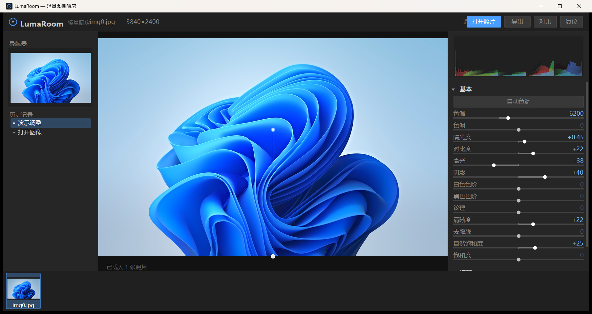

# LumaRoom · 轻量图像暗房

一个模仿 Lightroom Classic 布局的 Windows 原生图像处理工具，单文件 exe，零运行时依赖。
只保留照片处理最核心的三块能力：**基础影调调整**、**RAW 去杂色与降噪**、**蒙版局部编辑**。



---

## 运行

双击 `LumaRoom.exe` 即可，无需安装 .NET 之外的任何东西（Win7 SP1 及以上，系统自带 .NET Framework 4.x）。

也可以把照片拖到窗口上，或用命令行打开：

```
LumaRoom.exe "D:\photos\DSC_0421.NEF"
```

---

## 功能范围

### 基本面板（影调与色彩）

| 分组 | 参数 |
| --- | --- |
| 白平衡 | 色温 2000–12000K、色调 |
| 影调 | 曝光度 ±5EV、对比度、高光、阴影、白色色阶、黑色色阶 |
| 质感 | 纹理、清晰度、去朦胧 |
| 色彩 | 自然饱和度、饱和度 |

- **自动色调**：按直方图 1%/99% 分位自动定黑白场并给出曝光补偿。
- 所有调整都是非破坏性的，原图从不被改写；左侧「历史记录」可回退到任意一步。

### 细节面板（降噪与锐化）

| 参数 | 说明 |
| --- | --- |
| 亮度降噪 | 导向滤波（edge-preserving），保边平滑明度噪点 |
| 保留细节 / 对比度 | 控制残留的微细节与局部反差 |
| 颜色降噪 | YCbCr 域对 Cb/Cr 做大半径平滑，消除彩噪 |
| 细节 / 平滑度 | 控制色度去噪的保守程度，高强度时叠加 3×3 中值去孤立彩斑 |
| 锐化数量 / 半径 / 细节 | USM，带阈值门控，避免放大噪点 |

- **自动去杂色**：先用拉普拉斯响应的鲁棒分位数估计噪声 σ，再自动换算亮度/颜色降噪强度。
  这就是「RAW 照片自动去杂色」的入口——一键即可，也可以之后再手动微调。

### 蒙版面板（局部调整）

三种蒙版，直接在图上绘制：

| 类型 | 操作 |
| --- | --- |
| 线性渐变 | 在画面上按住拖拽，定义渐变方向与过渡 |
| 径向渐变 | 从中心向外拖拽定义半径，右键可调长宽比 |
| 画笔 | 涂抹生成蒙版，可切换「擦除」；`[` `]` 调整笔刷大小 |

每个蒙版都有独立的曝光 / 对比度 / 高光 / 阴影 / 色温 / 色调 / 饱和度，
编辑时画面上以红色半透明叠加显示作用范围。多个蒙版可叠加，可单独删除。

---

## 快捷键

| 按键 | 功能 |
| --- | --- |
| `Ctrl+O` | 打开照片 |
| `Ctrl+S` | 导出 |
| `\` | 前后对比（按住切换原图） |
| `空格` + 拖拽 | 平移画布 |
| 滚轮 | 缩放画布 |
| `0` | 适应窗口 |
| `[` `]` | 笔刷缩小 / 放大 |
| 双击滑块 | 复位该参数 |

---

## RAW 支持说明

内置了一个精简的 TIFF/RAW 解析器，不依赖任何第三方库：

1. 解析 TIFF 容器（CR2 / NEF / ARW / DNG / RW2 / ORF / PEF … 都是 TIFF 变体），
   读取 IFD、条纹偏移、位深、CFA 排列、黑/白电平、AsShotNeutral 白平衡。
2. 对未压缩 / PackBits 压缩的 CFA 数据做**双线性去马赛克**，转 sRGB。
3. 若主图是厂商压缩格式（如无损 JPEG、Nikon 压缩 NEF）无法直接解码，
   自动回退到文件中体积最大的**内嵌 JPEG 预览**，并在顶栏标注来源。

这意味着：
- 佳能 CR2、尼康 NEF/ARW、DNG 等**未压缩**机型可以直接打开并做真正的线性调整；
- 压缩 RAW 会使用内嵌预览（通常是全尺寸高质量 JPEG），画质略低于专业解码器，但可用于调色。

> 定位是「轻量版」：不做相机色彩矩阵标定、不做镜头校正、不做去马赛克的高阶算法。
> 需要极致画质时请用相机厂商软件或 Adobe DNG Converter 先转 DNG（未压缩）。

---

## 安装（可选）

只想双击 exe 用，跳过本节即可。要装进系统（开始菜单 / 卸载项 / 快捷方式），用安装包：

**LumaRoom-Setup-1.1.0.exe** —— Inno Setup 6 构建的向导式安装包，页面顺序固定：

> 欢迎 → 许可协议（MIT）→ 安装位置 → 附加任务 → 准备安装 → 安装进度 → 完成

界面为简体中文，系统语言非中文时自动切 English。

* 默认装到 `%LOCALAPPDATA%\Programs\LumaRoom`，路径可改，**不需要管理员权限**
* 附加任务：创建桌面快捷方式、创建开始菜单快捷方式、在「打开方式」中注册（JPG / PNG / TIFF / RAW）
* 完成页可勾选「立即运行」；卸载走「设置 → 应用 → 已安装的应用」或安装目录下的 `unins000.exe`

静默安装 / 卸载（脚本分发用）：

```bat
LumaRoom-Setup-1.1.0.exe /VERYSILENT /SUPPRESSMSGBOXES /TASKS="desktopicon,startmenuicon"
"%LOCALAPPDATA%\Programs\LumaRoom\unins000.exe" /VERYSILENT
```

---

## 从源码构建

需要 Windows 自带的 .NET Framework 编译器（无需 Visual Studio / .NET SDK）：

```bat
build.cmd
```

脚本调用 `%WINDIR%\Microsoft.NET\Framework64\v4.0.30319\csc.exe`，输出单文件 `LumaRoom.exe`。

---

## 自带自检

核心算法可以脱离界面验证：

```bat
LumaRoom.exe --selftest out_dir
```

会生成合成测试图（含已知 σ 噪声）与合成 CFA 的 DNG，逐项检查：
影调管线、曝光/色温方向、降噪降幅、三种蒙版的权重分布与局部作用范围、
RAW 去马赛克、JPEG 导出，并输出 `selftest-report.txt`。

其他命令行开关（用于自动化验证）：

```
--shot <png>      启动后截图并退出
--demo            载入后自动填入一组示例调整与蒙版
--export <file>   载入后直接按当前调整导出并退出
```

---

## 项目结构

```
LumaRoom/
├── LumaRoom.exe        编译产物（单文件）
├── build.cmd           一键构建
├── app.manifest        DPI 感知 / 兼容性声明
├── app.ico             程序图标（tools/mkicon.py 生成）
├── src/
│   ├── Program.cs      入口、命令行开关、截图
│   ├── MainForm.cs     LRC 式三栏布局、渲染调度、导出
│   ├── Theme.cs        深色主题、字体与绘制工具
│   ├── Widgets.cs      滑块 / 按钮 / 折叠面板 / 直方图 / 滚动容器
│   ├── CanvasView.cs   画布：缩放平移与蒙版绘制交互
│   ├── ListWidgets.cs  胶片条 / 历史列表 / 蒙版列表
│   ├── Model.cs        调整参数、蒙版模型、文档与历史
│   ├── Photo.cs        sRGB↔线性、色温增益、影调曲线
│   ├── Pipeline.cs     渲染管线 + 导向滤波 + 降噪 + 噪声估计
│   ├── Masks.cs        蒙版栅格化（线性 / 径向 / 画笔）
│   ├── Decoder.cs      GDI+ 解码 + TIFF/RAW 解析 + 内嵌 JPEG 回退
│   └── SelfTest.cs     无界面自检
└── tools/mkicon.py     生成 app.ico
```

---

## 实现要点

- **预览**：解码后把长边缩到 1300px 作为工作副本，所有调整在这份浮点缓冲上跑，
  8 核并行；一张 100 万像素的图，常规调整约 30–60ms 出图。
- **影调**：sRGB→线性→白平衡/曝光→sRGB→曲线（对比/高光/阴影/黑白场/去朦胧）→
  按亮度比例缩放回 RGB，保持色相。前两步合并成 3×1024 的查找表。
- **清晰度 / 纹理**：用积分式盒式模糊取低频层，再做亮度域 USM。
- **降噪**：亮度用导向滤波（He et al.）保边平滑；色度在 YCbCr 上做大半径平滑 + 中值去彩斑。
- **蒙版**：几何以 0–1 归一化坐标存储，预览与全分辨率导出各自栅格化；局部调整只在该蒙版的
  包围盒内重算影调并与全局结果按权重混合。
- **导出**：按原始分辨率重跑整条管线（超过 1600 万像素时等比缩小以控制内存），
  支持 JPEG / PNG / TIFF。

---

## 已知限制

- 不支持图层、曲线、HSL、镜头校正、裁剪、批量同步等 LRC 进阶功能（刻意精简）。
- RAW 解码为轻量实现，色彩科学与专业解码器存在差异。
- 单次打开大量超大图片时会自动释放较早的全尺寸位图，切回时重新解码（略有延迟）。
